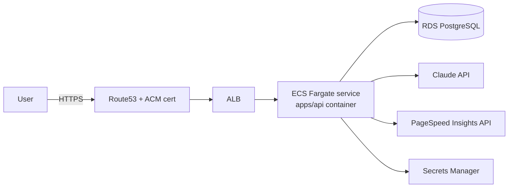

# Deploying the API to AWS

This covers deploying `apps/api` to AWS using **ECR + ECS Fargate + RDS Postgres**,
fronted by an ALB with a custom domain (e.g. `api.audit.foundryframe.com`). The
Next.js frontend (`apps/web`) is out of scope here — deploy it to Amplify/Vercel and
point `NEXT_PUBLIC_API_URL` at the API domain below.

## Architecture



## Prerequisites

- AWS CLI configured (`aws configure`) with an account/role that can manage ECR, ECS,
  RDS, ACM, Route53, Secrets Manager, and IAM.
- Docker installed locally (or use CI — see [CI/CD](#cicd)).
- A registered domain/hosted zone in Route53 (or delegate a subdomain to it).

## 1. Build & push the image to ECR

```bash
aws ecr create-repository --repository-name siteaudit-api

aws ecr get-login-password --region us-east-2 \
  | docker login --username AWS --password-stdin 574247905173.dkr.ecr.us-east-2.amazonaws.com

docker build -t ff-siteaudit-api ./apps/api
docker tag ff-siteaudit-api:latest 574247905173.dkr.ecr.us-east-2.amazonaws.com/ff-siteaudit-api:latest
docker push 574247905173.dkr.ecr.us-east-2.amazonaws.com/ff-siteaudit-api:latest
```

The image is a multi-stage build ([apps/api/Dockerfile](../apps/api/Dockerfile)) that
resolves dependencies with `uv` and ships a slim `python:3.13-slim-bookworm` runtime
running `uvicorn` on port `8000`, with a built-in `HEALTHCHECK` against `/api/v1/health`.

## 2. Provision RDS PostgreSQL

```bash
aws rds create-db-instance \
  --db-instance-identifier ff-siteaudit-db \
  --engine postgres \
  --engine-version 16 \
  --db-instance-class db.t4g.micro \
  --allocated-storage 20 \
  --master-username audit \
  --master-user-password '<generate-a-strong-password>' \
  --db-name audit \
  --vpc-security-group-ids <sg-id> \
  --no-publicly-accessible
```

- Put RDS in private subnets; only allow inbound `5432` from the ECS task security group.
- Note the resulting endpoint for `DATABASE_URL` below.

## 3. Store secrets in Secrets Manager

```bash
aws secretsmanager create-secret --name ff-siteaudit/api --secret-string '{
  "DATABASE_URL": "postgresql+asyncpg://audit:<password>@<rds-endpoint>:5432/audit",
  "JWT_SECRET": "<random-32+ char secret>",
  "ANTHROPIC_API_KEY": "sk-ant-...",
  "PAGESPEED_API_KEY": "..."
}'
```

Reference this secret's individual keys from the ECS task definition (`secrets`
block) rather than baking values into the image or task definition as plain env vars.

## 4. Run the initial migration

Run `alembic upgrade head` once against the new database before the service takes
traffic — either as a one-off ECS task using the same image, or locally with the
RDS endpoint reachable (e.g. via bastion/SSM port-forwarding):

```bash
aws ecs run-task \
  --cluster ff-siteaudit-cluster \
  --launch-type FARGATE \
  --task-definition ff-siteaudit-api-migrate \
  --network-configuration "awsvpcConfiguration={subnets=[<private-subnet-ids>],securityGroups=[<sg-id>]}" \
  --overrides '{"containerOverrides":[{"name":"api","command":["uv","run","alembic","upgrade","head"]}]}'
```

Repeat this step after every deploy that includes new migrations.

## 5. ECS Fargate service

- **Cluster**: `ff-siteaudit-cluster` (Fargate).
- **Task definition**: 0.5 vCPU / 1GB is a reasonable starting size; container port `8000`,
  health check `CMD-SHELL curl -f http://localhost:8000/api/v1/health || exit 1`.
- **Task execution role**: `AmazonECSTaskExecutionRolePolicy` + `secretsmanager:GetSecretValue`
  on the secret above.
- **Task role**: only add permissions the app actually needs at runtime (e.g. SES/S3 if you
  wire up `boto3` for emailing leads or storing audit reports).
- **Service**: desired count 2 for HA, attached to the ALB target group, in private subnets
  with a NAT gateway for outbound calls to Anthropic/PageSpeed Insights.

Environment variables to set on the task (non-secret):

| Variable | Value |
|---|---|
| `ENVIRONMENT` | `production` |
| `AWS_REGION` | `<region>` |
| `CORS_ORIGINS` | `["https://foundryframe.com/audit"]` |

Secrets (from Secrets Manager): `DATABASE_URL`, `JWT_SECRET`, `ANTHROPIC_API_KEY`, `PAGESPEED_API_KEY`.

## 6. Load balancer + domain

1. Request a public ACM certificate for `api.audit.foundryframe.com` (DNS validation).
2. Create an internet-facing ALB in public subnets, HTTPS (443) listener using that cert,
   forwarding to the ECS target group (health check path `/api/v1/health`).
3. Add an HTTP (80) listener that redirects to HTTPS.
4. In Route53, create an `A`/`ALIAS` record for `api.audit.foundryframe.com` pointing at the ALB.
5. Point the frontend's API base URL (`apps/web`) at `https://api.audit.foundryframe.com`.

## CI/CD

Minimal GitHub Actions flow (build → push → deploy):

```yaml
name: deploy-api
on:
  push:
    branches: [main]
    paths: ["apps/api/**"]

jobs:
  deploy:
    runs-on: ubuntu-latest
    steps:
      - uses: actions/checkout@v4
      - uses: aws-actions/configure-aws-credentials@v4
        with:
          role-to-assume: ${{ secrets.AWS_DEPLOY_ROLE_ARN }}
          aws-region: <region>
      - uses: aws-actions/amazon-ecr-login@v2
        id: ecr
      - run: |
          docker build -t ${{ steps.ecr.outputs.registry }}/ff-siteaudit-api:${{ github.sha }} ./apps/api
          docker push ${{ steps.ecr.outputs.registry }}/ff-siteaudit-api:${{ github.sha }}
      - uses: aws-actions/amazon-ecs-deploy-task-definition@v2
        with:
          cluster: ff-siteaudit-cluster
          service: ff-siteaudit-api
          task-definition: task-definition.json
          # ...update the image tag in task-definition.json to the pushed tag first
```

Use OIDC (`role-to-assume`) rather than long-lived AWS access keys in GitHub secrets.

## Local verification before deploying

```bash
docker build -t ff-siteaudit-api:test ./apps/api
docker compose up --build -d      # brings up db + api together (see docker-compose.yml)
curl http://localhost:8000/api/v1/health
```

## Rollback

ECS keeps prior task definition revisions — to roll back, update the service to the
previous task definition ARN:

```bash
aws ecs update-service --cluster ff-siteaudit-cluster --service ff-siteaudit-api \
  --task-definition ff-siteaudit-api:<previous-revision-number>
```

## Checklist

- [ ] RDS created, in private subnets, security group locked to ECS tasks only
- [ ] Secrets in Secrets Manager, task execution role granted access
- [ ] `alembic upgrade head` run against the new database
- [ ] ECS service healthy behind ALB target group
- [ ] ACM cert issued + Route53 record for the API domain
- [ ] `CORS_ORIGINS` set to the real frontend origin(s)
- [ ] CI/CD pipeline building/pushing/deploying on merge to `main`
